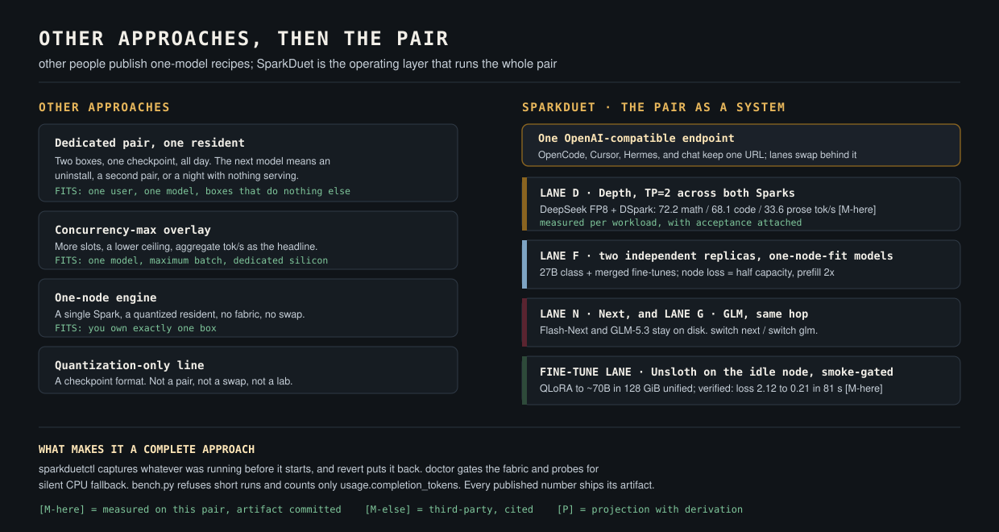

# SparkDuet vs other approaches

Other people publish one-model recipes for a DGX Spark pair: one checkpoint,
one boot line, dedicated boxes. That is a valid job. It is not SparkDuet.

SparkDuet is the operating layer for the pair. Four residents stay on disk.
RAM holds one. `switch` drains, boots, and confirms. `revert` puts the last
incumbent back. The OpenAI port never moves. The idle node trains. Every
published number ships an artifact.



Ladder labels: **[M-here]** measured by this repo's harness (artifact in
`results/`), **[M-else]** third-party measured (source cited), **[P]**
projection with derivation in `docs/ARCHITECTURE.md`.

---

## 1. What other approaches optimize

A single-model recipe answers "how do I serve this one checkpoint as fast as
possible on two boxes." Typical shape:

- One topology (usually TP=2).
- One ceiling, one utilization, boxes that run nothing else.
- A start script for that model only.
- A headline tok/s band that does not break out workload class.

That is the right tool when the pair has one job and you will uninstall the
resident to try the next one.

## 2. What SparkDuet is

SparkDuet answers "how do I run the whole AI workload on two Sparks":

| | Other approaches | **SparkDuet** |
|---|---|---|
| Scope | One model, served deeply | The pair as an operating system for models |
| Topology | Usually TP=2 only | TP=2 (Lane D / N / G) + DP=2 fleet (Lane F) + PD-split (Lane P, experimental) + fine-tune lane |
| Models at once | One resident | Four residents on disk, one in RAM, plus an on-demand library |
| Model swap | edit env, restart, or reinstall | `sparkduetctl.sh switch <lane>` with drain; incumbent capture + `revert` |
| Fine-tuning | out of scope | first-class lane: Unsloth on the idle node, smoke-gated [M-here] |
| Speculation | a static k | measured per-workload acceptance; advisor recommends k from {3,5,7} |
| Benchmarks | prompt × concurrency sweeps | per-workload suites (math, code, tool-calling, prose) with acceptance attached |
| Ops | start / stop / status | doctor, nccl-check, warmup, JIT-cache persistence, revert |
| Context default | often a dedicated-pair 1M / high util | 1M ceiling, util 0.78, 1.01M KV pool on a shared head; pickers 85% of the pool |

## 3. Numbers this pair actually measured

Decode speed is workload-shaped when speculation is on. Draft acceptance is
what moves tok/s. Plan capacity from the class you run, not from a headline.

### Single-stream decode, 2x Spark TP=2, DSpark speculation

| Workload | SparkDuet [M-here] | Acceptance [M-here] |
|---|---|---|
| Math | **72.2 tok/s** | 0.78 |
| Code | **68.1 tok/s** | 0.70 |
| Tool-calling | **51.2 tok/s** | 0.50 |
| Prose | **33.6 tok/s** | 0.23 |

The same engine is 72 tok/s on math and 34 tok/s on prose [M-here] because
acceptance falls from 0.70 to 0.23. Artifacts:
`results/2026-08-25-deepseek-v4-flash-tp2-laneD-*`.

### KV pool and context: read your own boot line

| | SparkDuet boot 29 Aug 2026 [M-here] |
|---|---|
| Ceiling | 1,048,576 tokens |
| GPU util | 0.78 (head node also runs a gateway stack) |
| KV pool | 1,014,644 tokens (0.97× of 1M) |
| Full-ctx concurrency | 0.97x of 1M |

A quoted 2.49M-token pool [M-else] is a different utilization on a pair that
runs nothing else. This house keeps 0.78 so one box also runs the router,
Open WebUI, Caddy, and a Telegram bot. `docs/MODELS.md` walks the trade.

### What only this repo measures

| Capability | Result [M-here] | Artifact |
|---|---|---|
| On-demand 27B GGUF while the flagship idles | 9.7 tok/s, llama-swap cold-load | `results/2026-08-25-qwen27b-gguf-spark2-ondemand-standard-CLEAN.*` |
| Same server during a TP=2 rank load (contention) | 1.4-2.2 tok/s [M-here], GPU silently lost | `results/...CONTENDED-laneD-boot-*` and `docs/FIELD-NOTES.md` §5 |
| QLoRA fine-tune smoke on the worker | loss 2.12 -> 0.21 in 81 s | `finetune/` lane |
| NCCL fabric after container RDMA fix | 42.0 GB/s bus BW (was 4.0 silently on TCP) | `scripts/nccl-check.sh` |

## 4. When another approach is the better fit

- **One Spark only.** SparkDuet is a two-node system. A one-box engine is the
  right choice if you do not have a pair.
- **One person, one model, dedicated boxes, million-token documents.** A
  single-model recipe with a dedicated-pair utilization will buy a larger KV
  pool than this house default. SparkDuet still serves 1M; it just leaves
  headroom for the gateway stack.
- **Maximum aggregate on one checkpoint.** A concurrency-max overlay can post
  higher aggregate tok/s at a lower ceiling. This repo does not ship that
  overlay. Lane F is the house answer for one-node-fit models: two replicas,
  half-capacity degrade.
- **Four boxes.** TP=4 is parameterized in Lane D configs. This pair has not
  run it.

None of those cases make SparkDuet a derivative of another lab's launcher.
They are different jobs.

## 5. Where SparkDuet is complete

- **Team and agent-fleet serving.** Lane F: two independent replicas of
  one-node-fit models. Node loss is half capacity, not total loss.
- **The model after this one.** Env-driven, branch-scoped
  (`docs/MODEL-SWAP.md`). A new flagship is a `model/*` branch, not a rewrite.
- **Fine-tuning on the same metal.** Smoke-gated, documented end to end
  (`finetune/README.md`).
- **Reversibility.** Capture before every start. `revert` restores it.
- **Refusal-enforced measurement.** `bench.py` refuses short runs, counts
  only `usage.completion_tokens`, and stamps workload class and acceptance.

## 6. Reproduce every number on this page

```bash
./scripts/sparkduetctl.sh start depth && python3 scripts/bench.py --suite standard
./scripts/sparkduetctl.sh switch fleet && python3 scripts/bench.py --suite fleet
```

Each run appends a dated artifact to `results/` with ladder labels. PRs that
change numbers must include the artifact.
